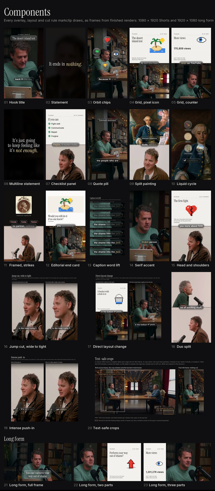
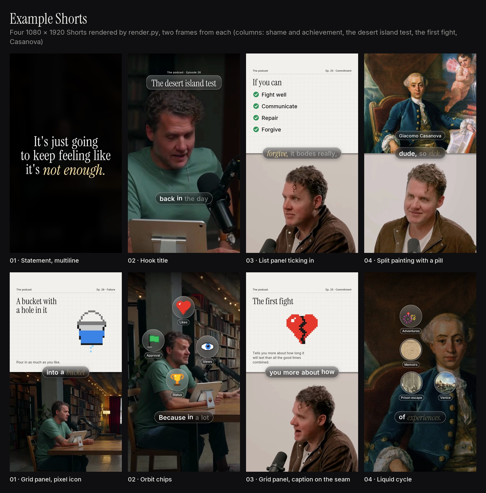
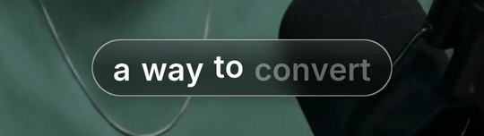
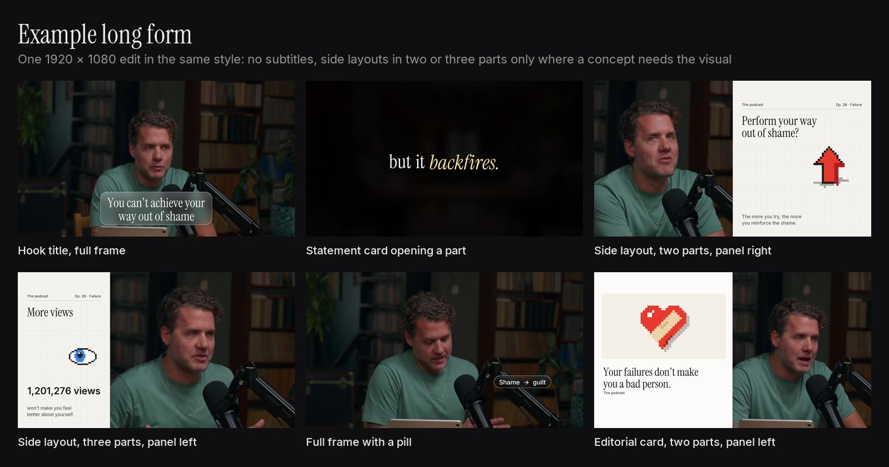
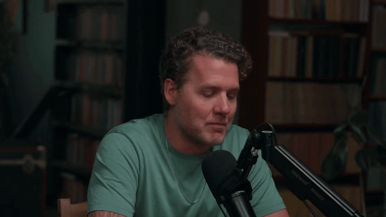

# Mark Clip (markclip)

An editable content library and Claude skill for turning talking-head video (podcasts, interviews, explainers) into
finished videos in one premium house style: **Shorts and Reels** with captions that light up word by word, and
**long-form edits** in the same look without subtitles. Every video comes with measured proof that it meets the house
rules: nothing over a face, eyes on one line, captions in sync, music audible under the voice, loudness on target.



## Showcase

Finished examples rendered by the skill's own scripts.


*Shorts (1080x1920), two frames from each bundled example spec: a serif statement, a glass hook title, a checklist
panel, a split painting with a name pill, grid panels with pixel icons, orbit chips and the liquid cycle.*


*The caption: a dark glass pill settles in and each word brightens with a small lift as it is spoken.*


*Long form (1920x1080): the full-frame speaker, statement cards that open the later parts, side layouts in two and three
parts, no subtitles.*


*A side layout: the speaker in one part, an animated panel in the other, the eye line held across the change.*

## What it does

**Shorts and Reels (1080x1920)**
- **Finds the moment.** A whole thought with a hook in its first sentence, the speaker on camera in the first 5 s,
  and no ad reads, checked against the job's brief.
- **Cuts the base edit.** Only repeats, restarts, long fillers and dead air of 1 s or more are cut, never mid-word.
  Every camera shot gets one fixed 9:16 crop with the eyes on a constant line; a jump cut inside one shot switches
  between a wide and a tight crop so it reads as a second camera. Crops never cut through burned-in show text.
- **Captions every word.** Captions are timed from the final edit's own audio and light up word by word inside a dark
  glass pill, in Inter and Instrument Serif, sentence case only.
- **Adds the graphics.** Motion graphics come from a small JSON spec: glass titles, split-screen grid panels with pixel
  icons, orbit chips, checklists, quote pills, editorial end cards and full-frame serif statements. Nothing is ever
  placed over a face.
- **Mixes the sound.** Famous on-topic music sits 10-12 dB under the voice, clicks and paper turns around -15 dB,
  the mix at -14 LUFS.
- **Checks the result.** Nine measured QA gates: spec lint, duration, caption sync, music level, loudness, face
  clearance, still captions, no zoom bounce and eye level.

**Long form (1920x1080)**
- The same cutting, framing, type, graphics and sound, without subtitles.
- Full frame most of the time, eyes on one line, wide shots kept wide.
- Built from two or three parts: the hook title opens the first, a full-frame serif statement card each later one.
- A side layout only where a concept needs a visual: the frame in two parts (speaker half, animated panel half) or
  three (speaker two thirds, panel third), with the panel on either side.
- Eight measured QA gates (no caption sync, since there are no captions).

## Requirements

- **The ClipIt skill**, installed separately (default `~/.claude/skills/clipit`, with its Python environment in
  `~/.clipit/venv` created by ClipIt's `install.sh`). markclip uses it for fetching sources, transcripts, the face model and
  audio helpers. Set `CLIPIT_DIR` if it lives somewhere else.
- **An Apple Silicon Mac**: every transcription runs Whisper large-v3 through `mlx-whisper` (the model is fetched on
  first use, about 3 GB). OpenCV, NumPy, Pillow, pyloudnorm and yt-dlp come with ClipIt's environment.
- **ffmpeg and ffprobe** on the PATH.
- Optional: **Node 16+** to run a batch gate ledger with [unlazy](https://github.com/Leonxlnx/unlazy).

## Install

- **Claude Code:** clone this repository into your skills folder, so that you end up with
  `~/.claude/skills/markclip/SKILL.md`:
  ```
  git clone https://github.com/shasshhaank/markclip ~/.claude/skills/markclip
  ```
  Or put it in `.claude/skills/markclip/` inside a project.
- **Claude apps:** upload the zip under *Settings → Capabilities → Skills*. The scripts still need a Mac with ClipIt to
  render; in the apps the skill can plan moments, write specs and posting files.

## Usage

Ask in plain words, for example:

- *"Make 4 markclips from this episode, 2 Shorts for YouTube and 2 Reels for Instagram: https://www.youtube.com/watch?v=..."*
- *"Clip 1:12:40-1:13:30 of this interview in the markclip style."*
- *"Make a long-form markclip of 41:00-49:30, in three parts, with an animated side panel where the bucket metaphor
  comes up."*
- *"Here is the brief for this clipping job: fill in the checklist and pick moments that meet it."*
- *"Re-time spec 03 onto the rebuilt base and render it again."*

### How a Short is made

Run from one job folder, with `PY=~/.clipit/venv/bin/python`, `S` set to this folder and `CLIPIT_DIR` to ClipIt's.
`SKILL.md` has every flag, every output file and the reason behind each rule.

| Step | Command | Writes |
|---|---|---|
| 1. Pick moments | `$PY $S/scripts/episode_subs.py subs VIDEO_ID` | `subs/ID.txt`, `subs/ID.json` |
| 2. Extract | `$PY $CLIPIT_DIR/clip.py fetch --res 1080 --section A-B URL` | `input/<topic>_<start>-<end>.mp4` |
| 3. Base edit | `$PY $S/scripts/base_edit.py input/X.mp4 --start S --end E --out base/01.mp4`, then `heard_check.py base/01.mp4` | `base/01.mp4`, `.split.mp4`, `.plan.json`, `.crops.json`, `.voice.wav` |
| 4. Caption words | `$PY $S/scripts/words.py base/01.mp4 words/01.json` | `words/01.json` |
| 5. Faces and shots | `$PY $S/scripts/analyze_base.py base/01.mp4` | `base/01.faces.json` |
| 6. Spec | copy an example from `assets/examples/specs/`, then `$PY $S/scripts/lint_spec.py specs/01.json` | `specs/01.json` |
| 7. Render | `$PY $S/scripts/render.py specs/01.json` | `output/01_x.mp4`, `_mix.wav`, `.log.jsonl` |
| 8. QA | `$PY $S/scripts/check.py specs/01.json` | `output/01_x_bg.mp4`; prints `MARKCLIP CHECK PASSED` |
| 9. Post | write the posting files (`references/posting.md`) | `SEO_and_schedule.md`, `SEO_and_schedule_IG.md` |

### How a long-form video is made

The same steps, with `--long` on the base edit, no caption words, and a spec with `"format": "long"` (copy
`assets/examples/specs/05_long.json`; `references/long-form.md` explains every field):

```
$PY $S/scripts/base_edit.py input/X.mp4 --start S --end E --long --out base/05.mp4
$PY $S/scripts/analyze_base.py base/05.mp4
$PY $S/scripts/lint_spec.py specs/05.json
$PY $S/scripts/render.py specs/05.json
$PY $S/scripts/check.py specs/05.json
```

## What's inside

| Path | Contents |
|---|---|
| `SKILL.md` | the house rules with the reason for each, the Shorts workflow with every command and output, long form, options |
| `scripts/` | base edit and framing (Shorts and long form), repeat finder, caption word timing, face and shot analysis, renderer, spec linter, spec re-timer, QA checks |
| `references/` | the brief checklist, cutting formula, ClipIt extraction, framing, design system, design references, sound design, spec format, long form, QA gates, posting format |
| `assets/fonts/` | Inter and Instrument Serif, with their SIL Open Font License texts |
| `assets/examples/` | four complete Short specs with their caption word timings, and one long-form spec |
| `assets/snapshots/` | rendered stills of every component and of the caption, framing, cut and long-form layout rules (00-23) |
| `assets/showcase/` | finished examples: a Shorts sheet, a long-form sheet, the caption lift and a side layout in motion |
| `assets/design-references/` | the two looks the design is modelled on |
| `assets/templates/` | a QA-ledger template and two example posting files |

`references/design-system.md` explains every snapshot; `00_components_overview.jpg` puts the Shorts components and
the long-form layouts on one labelled sheet.

## Make it yours

Everything a video shows comes from its spec: set `"show"` to your show's name (panel headers and bylines), write
your own titles, statements and panels, pick your music, and add your show's burned-in text positions with
`MARKCLIP_TEXT_BOXES` if they differ from the usual chapter label, lower third and corner logo. New pixel icons are
small drawing functions in `scripts/engine_core.py`. The house rules and numbers live in `SKILL.md` and
`references/`; change them there, and keep `check.py` passing.

## Credits and third-party material

- **Fonts.** Inter (The Inter Project Authors) and Instrument Serif (The Instrument Serif Project Authors), both under
  the SIL Open Font License 1.1. The licence texts are in `assets/fonts/`.
- **Design references.** The files in `assets/design-references/` belong to their studios and are included only as
  visual reference for the model:
  - "Liquid Cycle" by 108.supply: https://www.pinterest.com/pin/1142506999243895572/
  - a pixel-grid animation by dgrees.studio: https://www.pinterest.com/pin/1079104760730137038/
- **Showcase and snapshot frames.** The frames in `assets/showcase/` and `assets/snapshots/` come from a publicly
  available interview podcast, and the example specs and word files hold words transcribed from it. They are included
  only to demonstrate the style. Music and pictures named in the examples are not included.
- **ClipIt** is a separate skill with its own terms; markclip only calls it.
- **No affiliation.** markclip is not affiliated with or endorsed by any show, podcast, studio or platform named or
  shown here, including 108.supply and dgrees.studio.
